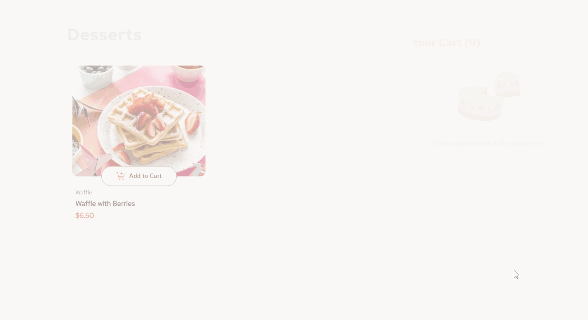
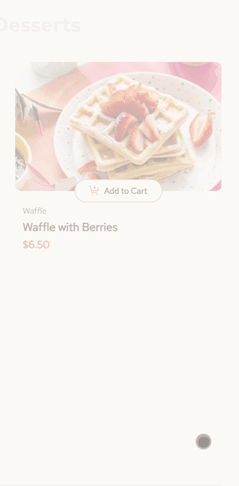

# 🧁 Product List with Cart

**A responsive dessert-shop UI with cart logic and animations: my solution to the [Product list with cart](https://www.frontendmentor.io/challenges/product-list-with-cart-5MmqLVAp_d) challenge on Frontend Mentor.**

<!-- TODO: once deployed, add: 🌐 **Live demo:** [your-url](https://your-url) -->

<p align="left">
  
  
  
  
  
  
  
</p>

<p align="center">
  
  <br>
  <em>Desktop: add desserts to the cart, adjust quantities, remove items and confirm the order</em>
</p>

## 📌 About this project

This was my first Frontend Mentor challenge. [Frontend Mentor](https://www.frontendmentor.io) provides professional designs and requirements, and the goal is to build a solution that matches the design as closely as possible. I used it to practice React state management, building the UI from a real design, and adding animations.

## ✨ Features

Users can:

- 🛒 Add items to the cart and remove them
- ➕ Increase or decrease the number of items in the cart
- ✅ See an order confirmation modal when they click "Confirm Order"
- 🔄 Reset their selections when they click "Start New Order"
- 📱 View the optimal layout for their device's screen size
- 🖱️ See hover and focus states for all interactive elements on the page

<p align="center">
  
  <br>
  <em>Mobile: the same experience, adapted to a small screen</em>
</p>

## 🧰 Tech stack

| Area       | Technologies                    |
| ---------- | ------------------------------- |
| Language   | JavaScript                      |
| Framework  | React                           |
| Animations | Motion (formerly Framer Motion) |
| Styling    | CSS Modules, CSS Flexbox        |
| Tooling    | Vite, ESLint                    |

## 🌱 Continued development

In the future I want to focus on creating more reusable components, managing state the correct way, and paying more attention to the application's performance.

## 📚 Useful resources

- [React Motion tutorial](https://www.youtube.com/watch?v=31y7-k3ZG0g&t=475s): helped me when I was implementing the animations
- [Motion docs](https://motion.dev/docs/react-quick-start): the official documentation, which also helped with the animations
- [The Ultimate React Course 2024: React, Next.js, Redux & More](https://www.udemy.com/course/the-ultimate-react-course/): the course I'm completing. It greatly helped me understand the proper use of state, how to share state between components, derived state, and key React development concepts and patterns.

## 🛠️ Local development

**Requirements:** Node.js

1. Clone the repository and install the dependencies:

   ```
   npm install
   ```

2. Start the development server:

   ```
   npm run dev
   ```

3. Open the URL shown in the terminal (by default [http://localhost:5173](http://localhost:5173)).

## 👤 Author

- GitHub: [@TaseZmaj](https://github.com/TaseZmaj)
- LinkedIn: [Stefan Tasevski](https://www.linkedin.com/in/stefan-tasevski-32b959312/)
